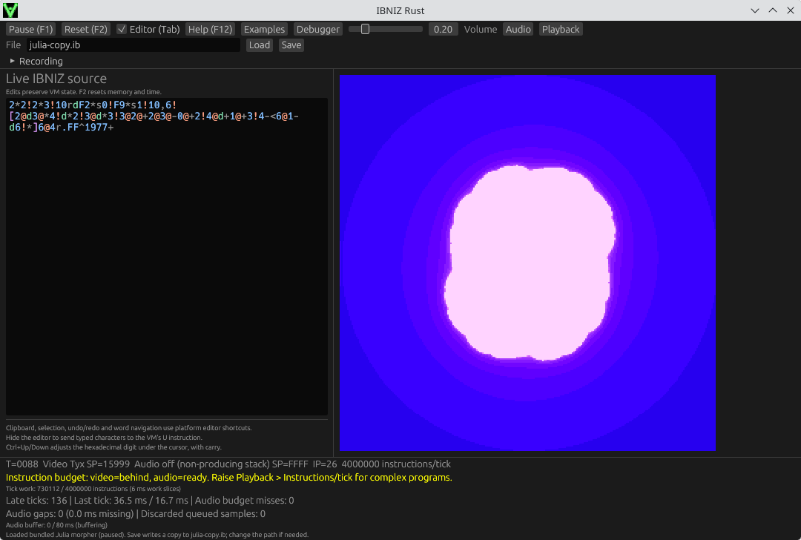

# IBNIZ Rust documentation

See the [README](README.md) for a project overview and quick start.

## Contents

- [Installers](#installers) and [publishing a release](#publishing-a-release)
- [Running from source](#run) and [Linux desktop integration](#linux-desktop-integration)
- [Live editor](#live-editor) and [bundled example browser](#bundled-example-browser)
- [VM debugger](#vm-debugger) and [playback tuning](#playback-tuning)
- [Realtime variable FPS](#realtime-variable-fps)
- [GUI recording](#gui-recording) and [NSM sessions](#nsm-sessions)
- [Headless rendering](#headless-rendering)
- [Language, VM library and compatibility](#language-and-vm)
- [Development](#development) and [playback benchmark](#playback-benchmark)
- [License](#license)

IBNIZ Rust implements [IBNIZ](https://github.com/viznut/IBNIZ),
Ville-Matias Heikkila's compact audiovisual virtual machine. It includes a live
editor, video and sound, a reusable VM library, and headless PPM/WAV rendering.
This is an **altered implementation**, not the original C distribution.

## Screenshot



## Installers

Download installers and `SHA256SUMS` from **GitHub Releases**. Pushing a version
tag builds the following packages:

| Platform | Installer | Compatibility |
|----------|-----------|---------------|
| Debian / Ubuntu | `.deb` | x86-64, Debian 12+ / Ubuntu 24.04+ |
| Fedora | `.rpm` | x86-64, Fedora 43+ |
| macOS | `.dmg` containing `IBNIZ Rust.app` | Separate Intel (`x86_64`) and Apple Silicon (`arm64`) builds, macOS 11+ |
| Windows | `.msi` | x86-64, Windows 10/11 |

| Platform | Installation |
|----------|--------------|
| Debian / Ubuntu | `sudo apt install ./ibniz-*.deb` |
| Fedora | `sudo dnf install ./ibniz-*.rpm` |
| macOS | Open the disk image and drag the app into **Applications**. |
| Windows | Run the MSI, then open a new terminal to use `ibniz` on `PATH`. |

The Windows installer adds Start menu and uninstall entries. Its runtime is
statically linked; no separate Visual C++ runtime is needed.

**Security:** macOS builds are only ad-hoc signed, not Developer ID signed or
notarized. Windows builds have no publisher signature. Gatekeeper/SmartScreen
may require approval. Verify the download source and checksum first.

When launching from Finder, use writable absolute paths for files and
recordings. Do not rely on the app's working directory.

**FFmpeg is not bundled.** Install it separately for optional MP4 conversion.

### Publishing a release

The release workflow is `.github/workflows/installers.yml`.
Before creating a tag:

1. Update `[package].version` in `Cargo.toml`.
2. Refresh `Cargo.lock` with Cargo.
3. Commit both files, then create and push the matching tag:

```sh
# After committing the version bump and updated Cargo.lock:
git tag v0.2.0
git push origin v0.2.0
```

Tags may use `v0.2.0` or `0.2.0`. The version must match Cargo exactly.
SemVer prereleases, such as `v0.2.0-rc.1`, become GitHub prereleases.
Invalid tags and version mismatches fail before installer builds begin.

The common installer version limit is `255.255.65535`.
Windows MSI compares only the numeric version core. Prereleases and build
metadata with the same core can replace each other. Debian/RPM prereleases
sort before the final release.

All five builds must succeed before publication. Runners install and check
Linux and Windows packages. They verify macOS disk images and check the bundled
executable. Assets are also kept as workflow artifacts.

A release stays in draft until all installers and checksums are uploaded.
Rerunning the workflow refreshes its assets. Only the publishing job has
release-write permission. No signing secrets are required.

Packaging uses Python 3.11+ and native `dpkg-deb`/`dpkg-shlibdeps`, `rpmbuild`,
macOS `sips`/`iconutil`/`codesign`/`hdiutil`, and WiX 5.0.2 with its matching UI
extension. For local packaging after building the native release binary:

```sh
python3 -m unittest discover -s packaging -p 'test_*.py'
python3 packaging/package.py build --tag v0.1.0 --format deb \
  --binary target/release/ibniz
```

Match the tag to the package version. Choose your host's format: `deb`, `rpm`,
`dmg`, or `msi`. On Windows, use `ibniz.exe`. For macOS, pass `--arch x86_64`
or `--arch arm64`. Output goes to `target/installers/`.

See the [release procedure](.github/RELEASE.md) for the full checklist.

## Run

Install Rust 1.88 or newer, then:

```sh
cargo run --release
cargo run --release -- examples/ibnizdemo.ib
cargo run --release -- -c '^xp M d3r15&*'
```

The desktop uses egui/OpenGL and CPAL rather than SDL.

| Platform | Build requirements |
|----------|--------------------|
| macOS | Xcode Command Line Tools: `xcode-select --install` |
| Windows | Rust MSVC toolchain and Visual Studio C++ build tools |

On Debian/Ubuntu, install `build-essential pkg-config libasound2-dev libx11-dev libxi-dev
libxcursor-dev libxrandr-dev libxinerama-dev libgl1-mesa-dev libwayland-dev
libxkbcommon-dev`.

**Keep volume low.** Sound starts at 20%, but programs can produce loud,
abrupt noise. Use `--no-audio` to disable the output device. If audio
initialization fails, the app shows an error. Editing and video remain usable.

### Playback DC blocker

**Audio > DC blocker** enables a 20 Hz high-pass filter. It is **on by default**.
It removes sustained DC offset and attenuates some very low bass. Uncheck it
for unfiltered playback.

The filter runs at the output device's sample rate. It keeps its state
between callbacks, including during silence. It does not change the VM or
headless WAV exports; exports use the separate `--dc-blocker` flag.
Outside NSM, restarting the app enables the filter again.

**This is not a limiter or a guarantee of speaker or hearing protection.**

### Linux desktop integration

`assets/ibniz.svg` is the scalable application icon. The desktop launcher
`assets/ibniz.desktop` uses the icon name `ibniz`, matching the application's
Wayland app ID and X11 window class.

To install for the current user:

```sh
cargo build --release
install -Dm755 target/release/ibniz "$HOME/.local/bin/ibniz"
install -Dm644 assets/ibniz.svg "$HOME/.local/share/icons/hicolor/scalable/apps/ibniz.svg"
install -Dm644 assets/ibniz.desktop "$HOME/.local/share/applications/ibniz.desktop"
```

Ensure `$HOME/.local/bin` is on your desktop session's `PATH`.
The native window embeds `assets/ibniz.png`, so it does not need external
asset files at runtime. To regenerate this PNG after changing the SVG,
install librsvg and run:

```sh
rsvg-convert --width 256 --height 256 --output assets/ibniz.png assets/ibniz.svg
```

## Live editor

| Control | Action |
|---------|--------|
| F1 | Run / pause |
| F2 | Reset memory, stacks and time |
| F3 | Step one VM instruction while paused, with no active/finishing recording |
| F12 | Show / hide help (shortcuts, instruction reference and bundled full manual) |
| Tab | Show / hide editor |
| Ctrl/Cmd+S | Save to the file path above the editor |
| Ctrl+Up / Ctrl+Down | Increment / decrement the hex digit under the cursor, with carry |
| Esc | Cancel confirmation, close help, the example browser or debugger, otherwise exit |
| Load / Save | Open / save the specified UTF-8 `.ib` file |
| Examples | Browse, search and load bundled programs |
| Debugger | Inspect stacks/memory and single-step execution |

### Editing and errors

Use platform-standard selection, clipboard, word navigation and undo/redo.
Theme-aware colors distinguish numbers, comments, control flow, stack/media
instructions and data-section modes.

Changes recompile immediately **without resetting VM state**. Compile errors
underline the offending character. Hover for details or read the diagnostic
below the source. Columns count Unicode characters, not UTF-8 bytes.

Errors suspend playback until corrected. Reset uses the last valid program.
A `T` instruction stops execution; use **F2**, then **F1**, to start again.

### Fixed-tick playback

**Fixed ticks** is the default mode. Each tick has an instruction limit set by
`--max-instructions` (default 4,000,000). The app reports budget exhaustion
instead of freezing. Playback slows if a tick takes longer than 1/60 second.
For clock-driven playback, see [Realtime variable FPS](#realtime-variable-fps).

Lower preview rates skip RGB conversion and texture uploads on undisplayed
ticks, unless recording needs the image. RGB storage is reused.
VM/audio ticks and full-rate recordings do not change. Debugger steps always
refresh the image, including direct writes without a page flip.

**Playback > Instruction budget presets** offers **Default (4M)**,
**Complex (64M)**, and **Very complex (128M)** instructions per tick. The
**Instructions/tick** field still accepts custom budgets, including those
specified with `--max-instructions`. Selecting a preset changes only the
numeric budget for the next tick. It does not reset memory, restart partial
work, change work slices, or enable automatic adjustment.
NSM saves the numeric budget in the existing session format.

Higher budgets can complete complex pages, but may exceed the 16.7 ms deadline
and cause audio gaps. Work uses 1024-instruction chunks within the selected
UI work slices. Audio reserves one quarter of the budget.

Each completed tick supplies 1024 samples at 61440 Hz and, during recording,
one image. Slow playback does not skip recorded frames or change the audio
scheduler to manufacture 60 Hz output. Headless export changes only if you
pass a different `--max-instructions` value.

### Playback diagnostics

The status bar shows stack pointers, video mode, time, instructions and audio
health. In fixed-tick mode, it reports:

| Indicator | Meaning |
|-----------|---------|
| **Audio gaps** | Output callbacks without ready audio, including recovery buffering, and total missing duration. |
| **Late ticks** | Missed 60 Hz deadlines, including UI and scheduling delays. |
| **Last tick** | Rendering work time against the 16.7 ms target. |
| **Audio budget misses** | Ticks that could not generate all audio within the budget. The output queue may still have samples. |
| **Video budget misses** | Ticks that reached the instruction limit before a page flip. |
| **Tick work** | Current/last tick instructions and budget, separate from the next tick's configured budget. |

**Audio gaps** turns yellow after a gap or queue overflow. Startup, pauses and
compile-error suspension do not count. One interruption can span several
callbacks. The counter detects starvation, not expression-generated clicks
or every possible device glitch.

Budget misses and deadline misses are separate. A fast tick can exhaust its
instructions; a complete frame can miss its deadline. Terminated programs
do not count as media-budget misses.

Counters survive edits and pauses. **F2** or loading a file resets them.

### Input and unsaved changes

Mouse coordinates, buttons and modifiers feed `U`. Hide the editor to send
typed characters to the VM.

Files are saved exactly as entered. Use the file path field instead of the
original editor's `\#file` convention.

Loading a file or example, or exiting, asks before discarding unsaved changes.
**Cancel** or **Escape** keeps your edits so you can save first.
**Discard** proceeds without saving. Failed loads preserve the source and VM.
Under NSM, ordinary exit also protects unsaved settings. Manager-requested
termination never prompts.

### Bundled example browser

Click **Examples** to browse all 284 bundled programs, grouped into **Fractals**,
**Textures**, **Music**, **Demos**, and **Other**. Search matches titles,
filenames, descriptions, contributors and source collections, ignoring case.
Select an entry to see its description, credits, source link, license notice
and optional read-only source preview. Links are pinned where available.
If a source has no stated license, the browser says so. Collection maintainers
are not assumed to be the programs' authors.

**Load example** replaces the editor contents, resets the VM and audio queue,
and pauses playback. Press **Run** when ready. **Some examples flash rapidly
or produce loud noise.** Unsaved edits require confirmation.

The suggested path is `<example>-copy.ib` in the current directory, not the
bundled source file. Change it before saving if needed. Playback settings
are retained. An active recording stays armed, but capture pauses until **Run**.
`oneliners.ib` is a commented collection: uncomment one program before running.

Programs, metadata and license notices are embedded in the executable.
The browser works offline and outside the repository. Only external source
links need a browser and network connection.

### VM debugger

1. Click **Debugger**.
2. Pause with **F1**.
3. Use **Step (F3)** or **F3** to execute one instruction.

A number literal counts as one instruction, not one per character.
The implicit end-of-program operation also counts. Steps are silent and
refresh the preview without resetting the VM. **Run** resumes the same state.
A `T` instruction terminates execution; use **F2** before stepping again.

Stepping preserves normal audio/video scheduling. In fixed-tick mode, it
retains partial work and advances time only when a tick completes or reaches
its budget. In realtime mode, the paused clock stays frozen and stepping
bypasses page pacing.

The debugger shows the active context, instruction pointer, execution count
and next instruction. Choose **Active**, **Video** or **Audio** to inspect
data and return stacks. Each view shows SP/RSP and up to 64 slots, top-first.

These are **cyclic buffers, not bounded stacks**. Old slots stay visible.
The row count is not a logical stack depth. Return-stack values are raw
addresses/counts, not necessarily fixed-point numbers.

The read-only memory viewer covers all **00000-FFFFF physical word addresses**
in 128-word pages. Enter a hexadecimal address, navigate pages, or jump to the
selected context's **SP/RSP**. Values appear as raw eight-digit hexadecimal;
hover for signed-integer and 16.16 interpretations.

The editor highlights the **next instruction** while the debugger is open.
An EOF marker shows the implicit end instruction. Its line/column label works
even after comments or data. Invalid drafts hide the highlight.

You can inspect stacks and memory while running or recording. Stepping
requires paused playback, valid source and a fully finished recording.
NSM does not save debugger window/view choices.

### Playback tuning

The **Playback** menu changes tuning settings live, without resetting the VM.
Changing the playback **mode**, unlike tuning, resets and pauses the VM.

| Setting | Effect |
|---------|--------|
| Preview refresh: 15 / 30 / 60 fps | Limits display texture updates; defaults to 60 fps. VM execution and 60 fps recordings are unchanged. |
| Instructions/tick | Total VM instruction limit, initially `--max-instructions`. Changes apply to the next tick; higher limits allow more complex expressions but can slow playback. |
| Work slice: 1-128 ms | VM work per UI update, default 6 ms. Lower values favor editor responsiveness; higher values favor throughput. |
| Minimum audio buffer: 20-2048 ms | Startup/recovery buffering, default 80 ms. Higher values tolerate jitter at the cost of playback latency. |

For dropouts or rising **Audio gaps**, increase **Work slice** or
**Minimum audio buffer**:

| Adjustment | Benefit | Cost |
|------------|---------|------|
| Larger work slice | More time to generate audio per UI update | Less responsive editor |
| Larger minimum buffer | More tolerance for scheduling delays | More playback latency |

Expensive ticks resume across UI updates instead of blocking for their full
budget. Deadlines are checked every 1,024 instructions. Tick completion can
also require image conversion, so the work slice is **not a strict
wall-clock cap**. The status bar shows instructions in progress.

Pausing preserves partial work. Resetting or loading a program discards it.
**Last tick** sums rendering work across slices, excluding waits between
UI updates.

Audio is resampled outside the output-queue lock. Playback waits for real
samples rather than padding the queue with silence. After starvation, the
target grows by 20 ms, up to 2048 ms, before playback resumes. Short 5 ms fades
soften transitions to and from silence.

The status bar shows queued audio and the current target. Pause/reset clears
the queue and restores the selected minimum. Changing the minimum updates
the target immediately. The queue cap is the larger of 250 ms or the target
plus 50 ms. Discarded samples are counted.

Buffering helps with short delays, not sustained overload. A program that
consistently generates audio too slowly can still cause gaps. Buffering and
fades affect speakers only, not VM audio, headless output or GUI recordings.

#### Realtime variable FPS

Select **Playback > Realtime variable FPS**, then press **F1** to run.
Switching to or from **Fixed ticks (default)** resets memory, stacks, time and
diagnostics, then pauses playback. Source and other playback settings remain.

The clock uses 1/60-second units of active playback. Unfinished video work
continues across clock ticks and UI slices, with no per-page instruction
budget. At most one page completes per clock tick; expensive pages finish
less often. At a flip, video time catches up to the clock rather than
deliberately slowing the whole animation.

Preview refresh still limits display updates, not VM execution. It refreshes
visible memory even without a flip, preserving direct writes.

The scheduler prioritizes generating audio ahead of the clock using the
selected/adaptive buffer target, then works on video. Context switches still
need normal VM media boundaries. **Code stuck in an inner loop can block
audio progress.**

If audio falls more than four ticks behind, its sample time jumps forward
instead of generating an unbounded stale backlog. **Skipped audio** reports
these samples separately from device **Audio gaps**. Sustained overload can
still interrupt sound.

The configured work-slice limit still applies, checked every 1,024
instructions, so non-producing programs remain interruptible. Tick-budget
presets and the custom budget are disabled in this mode.

Status shows average completed pages/second over active playback, page count
and skipped audio, rather than fixed-tick budget misses. Pauses and compile
errors freeze the clock. Live recompilation preserves VM state and unfinished
work. Paused debugger stepping bypasses page pacing.

GUI recording is **fixed-tick only**. Switch modes before starting a take;
mode changes are blocked while a take is active or finalizing. Headless
rendering and fixed-tick library APIs are unchanged.

NSM saves the mode and restarts its clock from zero on load. Older sessions
use fixed ticks. This is original-style scheduling, not a cycle-exact
recreation of the SDL frontend or its macOS timer workaround.

### GUI recording

1. Select **Fixed ticks** mode.
2. Expand **Recording** and choose an output folder.
3. Click **Start recording**. If paused, press **Run** to begin capture.
4. Click **Stop recording** to finalize the take.

Recording captures future ticks without resetting playback. Each take gets
a new subfolder with `frame-000000.ppm`, etc., and `sound.wav`
(61,440 Hz, signed 16-bit mono).

**Recorded audio is full scale and unfiltered.** Speaker volume, the playback
DC blocker and audio-device availability do not affect it.
Keep playback volume low when opening recordings.

Run/pause and compile errors pause capture without inserting silence or
duplicate frames. Edits, resets and loaded programs appear in the same take.
VM termination stops recording. Closing the window confirms unsaved changes,
then waits for finalization with editing disabled.

Recordings follow the **VM's 60 Hz timeline**, not wall-clock time.
A slow expression still exports one frame per 1,024 audio samples.
Budget exhaustion can produce incomplete video or stale audio, as in headless
exports.

#### MP4 conversion

Check **Create MP4** before starting. After Stop, **ffmpeg-sidecar** encodes
`recording.mp4`, as in hydra-rust. It uses `ffmpeg` on `PATH` or alongside
the executable. **Nothing is downloaded automatically.**

FFmpeg must support `libx264` and AAC. Output is H.264/yuv420p at 60 fps with
AAC audio resampled to 48 kHz. PPM/WAV originals remain, even on failure.
Existing recordings are never overwritten. Encoder diagnostics go to the
take's `ffmpeg.log`.
An empty take creates only an empty WAV and skips MP4 conversion.

#### Recording limits and errors

Disk writes and encoding run off the UI thread with a bounded eight-frame
queue. If the disk cannot keep up, recording stops with a visible error rather
than silently dropping frames or accumulating memory. Queued frames are
finalized. Write/size-limit and FFmpeg errors appear in the status bar.
PPM sequences consume roughly 11.3 MiB/s, plus audio; WAV recordings are limited
to about 9.7 hours by the standard WAV file-size limit.

### NSM sessions

The desktop supports [New/Non Session Manager (NSM)](https://new-session-manager.jackaudio.org/):

1. Install the executable on `PATH`; see [Linux desktop integration](#linux-desktop-integration).
2. Add `ibniz` as a client in the session manager.

NSM supplies `NSM_URL`; no app flag is needed. Without it, the app runs
standalone. Invalid or unreachable managers show a warning and fall back to
standalone mode. Headless exports ignore `NSM_URL`.

#### Saved state

Each client uses the project directory assigned by NSM, containing a
self-contained `state.json`. It preserves:

- Editor source, including invalid drafts, and the last valid program.
- Run/pause, editor visibility, volume and DC blocker.
- Instruction budget, work slice, preview refresh, minimum audio buffer and
  playback mode.

Loading starts at **time zero** with memory, stacks and diagnostics reset.
It does not restore an execution snapshot. Invalid drafts stay visible and
suspend playback until corrected.

NSM Save and **Ctrl/Cmd+S** write state atomically. The ordinary file path is
locked and file Load is disabled. Bundled examples offer **Import example**
to keep saves in the session. The manager receives dirty/clean reports for
source and playback-setting changes.

Recordings default to `<project>/recordings`. Explicitly chosen external
folders are exports. **Stop recording and wait for finalization/conversion
before saving.** Until then, Save returns an explicit “not now” error.

#### Shutdown and limitations

NSM termination (`SIGTERM` on Unix) exits without confirmation or an implicit
save, even with unsaved edits. Queued recording frames are drained and WAV
headers finalized; optional MP4 conversion is skipped or cancelled so it does
not delay session shutdown. PPM/WAV originals remain available.

The client supports OSC over **UDP** and dirty-state reporting.
Live session switching and optional-GUI hiding are not advertised.
The manager must restart the client for another project. Audio uses CPAL;
NSM does not add JACK ports or connection restoration.

## Headless rendering

No window, audio device or desktop dependencies are required:

```sh
cargo run --release --no-default-features -- \
  --headless -c '^xp M d3r15&*' --frames 120 \
  --output output --wav output/sound.wav
```

Output is `frame-000000.ppm`, etc., plus an optional signed 16-bit mono WAV at
61,440 Hz. Each tick is 1/60 second with 1,024 samples.
**Existing numbered files are overwritten. Audio is full scale**, independent
of desktop volume.

WAV samples stream as each tick renders, so recording memory does not grow
with duration. Exports above the standard WAV size limit are rejected before
rendering.

### Filter exported audio

Add `--dc-blocker` alongside `--headless --wav FILE` to apply the same 20 Hz
high-pass filter to exported audio:

```sh
cargo run --release --no-default-features -- \
  --headless -c '^xp M d3r15&*' --frames 120 \
  --output output --wav output/sound.wav --dc-blocker
```

Headless filtering is **off by default**, unlike desktop playback.
It runs at 61,440 Hz, keeps state across ticks and clips peaks to signed 16-bit
range. It does not change the VM or video, or make recording memory grow
with duration.

### Convert with FFmpeg

Install FFmpeg, then run:

```sh
ffmpeg -framerate 60 -i output/frame-%06d.ppm -i output/sound.wav \
  -c:v libx264 -pix_fmt yuv420p -c:a aac -shortest output/demo.mp4
```

Run `cargo run -- --help` for all options.

## Language and VM

IBNIZ uses 32-bit signed 16.16 fixed-point values, hexadecimal literals,
cyclic data/return stacks, and a 1,048,576-word shared address space.
Video uses two 256x256 VVUU.YYYY pages, converted through paired YUY2
chrominance to RGB. Audio uses the low 16 bits as unsigned PCM internally.

```text
^xp                 XOR texture: Y XOR X, discard T
d3r15&*             "42 melody", in the audio context
^xp M d3r15&*       separate video and audio programs
```

The compiler/interpreter implements the full documented instruction set,
including `z`, loops, subroutines, return stacks, arbitrary memory access,
user input, data segments, and automatic TYX/T video mode detection.
The [original language manual](ibniz.txt) is the complete instruction reference.
It is also in **Help (F12) > Full language manual (bundled, offline)**.
The text is selectable and read-only; no browser or network is needed.

The manual is unchanged from
[upstream revision `3ba06ae5f2cf5765c0e06874a093f767054b6359`](https://github.com/viznut/IBNIZ/blob/3ba06ae5f2cf5765c0e06874a093f767054b6359/src/ibniz.txt)
under the [Zlib license](LICENSE). Its build and interface instructions
describe the original C version, not this frontend.

### Library API

```rust
use ibniz::{Program, Vm};

let program = Program::compile("^xp M d3r15&*").expect("valid IBNIZ source");
let mut vm = Vm::new(program);
let frame = vm.render_frame(4_000_000);
assert_eq!(frame.rgb.len(), 256 * 256 * 3);
assert_eq!(frame.audio.len(), 1024);
```

| API | Use |
|-----|-----|
| `Vm::step` | Execute one instruction. |
| `memory_mut`, `set_input`, `replace_program`, `reset`, `status` | Embed and debug the VM. |
| `begin_frame` / `FrameRender::advance_tick` | Render sliced ticks without RGB conversion. |
| `Vm::rgb_into(&mut Vec<u8>)` | Convert visible memory into reusable RGB storage. |
| `FrameTick::with_rgb` | Attach converted RGB to create a full `Frame`. |

**Convert before executing more instructions** to capture the completed tick's
image. Existing `render_frame`, profiled rendering, `advance` and `rgb` APIs
still produce full RGB images.

`RealtimeRender::new(&vm)` creates a separate realtime scheduler. Start from
a reset VM. Pass `advance` a monotonic 60 Hz playback clock, audio lookahead
in samples, and an instruction limit per batch.

`RealtimeBatch` returns available audio, page-completion events and skipped
samples, not fixed-duration frames. **Do not interleave realtime and fixed-tick
renderers on the same VM.**

Rendering uses compiler-side fusion hints for selected arithmetic, literal
memory accesses, and stack picks. Original instruction addresses, logical
instruction counts, popped-slot memory writes, and single-step behavior are
preserved. Fusion never exceeds a slice or tick instruction budget.
See [TODO.md](TODO.md#3-optimize-profiled-vm-hot-paths) for measured gains and
workload-dependent tradeoffs.

`export::WavWriter` streams a known sample count without requiring seekable
output. Wrap files in `std::io::BufWriter`. Call `finish` to verify the count
and flush buffered output.

### Compatibility

Reference: upstream commit `3ba06ae5f2cf5765c0e06874a093f767054b6359`
(the 1.18 interpreter). Tests include 168 C-generated snapshots covering
arithmetic, stack and control operations, comparing the stack top, SP and
the complete memory hash.

This is not a cycle-exact SDL frontend clone:

- Default playback and headless exports use deterministic 60 Hz ticks with
  bounded work. The desktop also offers [realtime variable FPS](#realtime-variable-fps).
  Sound is resampled to the output device's rate.
- Native code generation, legacy keystroke recording/playback and the
  original `-M` stream format are not implemented. Use PPM/WAV exports instead.
- Automatic audio/video role reversal is not implemented; with `M`, put
  video code first and audio code second.
- Flat conditional/subroutine skip points and the C interpreter's actual
  signed `l` shift behavior are preserved, including their quirks.
- Whitespace separates literals as documented (the C parser accidentally
  concatenates digits across whitespace). Unknown characters are diagnosed
  rather than silently executed as no-ops.
- Cyclic data reads and memory initialization work at all bit lengths,
  including 32-bit words; undefined C shifts and out-of-range reads are not
  reproduced. Negative jump values wrap as unsigned 32-bit addresses.
- Floating-point transcendental results and YUV-to-RGB rounding may vary
  slightly by platform. No unsafe Rust is used in the VM.

The [examples catalog](examples/README.md) lists all 284 programs, credits and
license notices. Sources include the original examples and manual, jibniz,
IBNIZ-js, shortest-program and Summerlab collections, TTjm and emoc/IBNIZ.

In the GUI browser, search **TTjm** for its 69 programs and variants.
Search **emoc** for its 42 distinct runnable expressions: 20 new and 22 already
bundled.

`oneliners.ib` is a commented collection. Uncomment a line to run it.
Its original Latin-1 nonbreaking space has been converted to UTF-8.

## Development

```sh
cargo test
cargo test --no-default-features
cargo clippy --all-targets --all-features -- -D warnings
cargo fmt --all --check
```

To exercise GUI MP4 encoding against installed FFmpeg and ffprobe:

```sh
cargo test --bin ibniz ffmpeg_encodes_recorded_video_and_audio -- --ignored
```

The core and headless build have no third-party dependencies. Desktop tests
exercise the editor and rendering UI without opening a native window.

### Playback benchmark

```sh
cargo run --release --locked --no-default-features --example playback_bench
```

The benchmark discovers every `.ib` file in `examples`, in filename order.
It includes empty and comment-only programs. Use `--examples-dir PATH` for
another directory. Compilation and file I/O are not timed.

Each case uses a persistent VM. Defaults are 60 warmup ticks, 300 measured
ticks and 4,000,000 instructions per tick.

CSV goes to stdout. Configuration, package version, OS/architecture and build
mode go to stderr. Also record `git rev-parse HEAD`, `rustc -Vv`, CPU model and
power settings. Repeat release runs on an otherwise idle machine with the
same options. **Timings are diagnostics, not portable pass/fail thresholds.**

#### Select programs and input

`--suite stress` selects the eight budget-limited examples listed in `TODO.md`.
`--suite controls` selects TV noise, plasma, XOR texture, and the multiplication
texture zoomer. `--filter TEXT` further filters filenames.

`--input all` is the default. It runs default input for every program, plus
center and sweep scenarios for programs using `U`:

| Scenario | Input |
|----------|-------|
| Center | Mouse at (128, 128) |
| Sweep | Coordinates 0..255, X reversed every 256 ticks, mouse-button bit toggled every 60 ticks |

The deterministic sequence starts at tick zero, including warmup.
Choose one scenario with `--input default`, `center`, or `sweep`.

#### Read timing and completion metrics

The CSV separates median/p95/worst **execution** time from **RGB conversion**.
Execution includes VM audio/video work and audio sample extraction.
Total tick time includes both stages and instrumentation overhead.

It also reports late ticks (over 16.7 ms), incomplete audio/video ticks,
budget hits, stopped ticks and mean instructions. Stopped programs are not
media misses. Disabled audio is not an audio miss.

Audio has one quarter of the tick budget. It can exhaust that reservation
without using the full tick budget. These misses are **not device xruns**.

#### Probe video-page completion

A separate VM starts from reset for `--page-frames N` ticks (default: 3).
`--page-cap N` limits each probe tick (default: 128,000,000 instructions).
Probes do not affect the timed run. They report completed pages, capped and
stopped ticks, and mean/max video-phase instructions per completed page.

Work carries across capped ticks. Unfinished work is reported separately and
excluded from completed-page statistics. Counts exclude the audio scheduling
phase, including video setup it may execute. They measure video-phase work,
not every instruction in the video context.

The cap covers the whole tick, with the usual audio reservation. Non-producing
programs cannot wait indefinitely. High-cap probes advance time differently
from low-budget playback. They are **a separate workload**, not an estimate
of missing instructions in the timed run.

#### Repeat the audit

For the original 30-second audit configuration, or a longer stress run:

```sh
cargo run --release --locked --no-default-features --example playback_bench -- \
  --warmup 0 --frames 1800 --input default > baseline.csv 2> baseline.log
cargo run --release --locked --no-default-features --example playback_bench -- \
  --suite stress --warmup 120 --frames 3600 > stress.csv 2> stress.log
```

#### Native texture-upload baseline

```sh
cargo run --release --locked --example playback_bench -- \
  --desktop --suite controls > desktop-baseline.csv 2> desktop-baseline.log
```

This opens a progress window without audio or flashing video. It measures
RGB-to-egui/RGBA preparation separately from a full 256x256 RGBA OpenGL upload.
`glFinish` measures completion, not just command queueing. GL vendor, renderer
and version are logged.

This is an isolated upload benchmark, not an editor paint measurement or
asynchronous production GPU trace. Total tick time includes preparation and
synchronization, but excludes layout, window presentation and vsync.
Closing the window early fails the run.

Headless runs leave texture-preparation/upload CSV fields empty (not zero);
`mode` and `upload_samples` identify whether uploads were measured. Neither mode
includes device callbacks, audio resampling, or recording I/O.

#### Compare instruction budgets

Use `--max-instructions N` to compare budgets, not wall-clock deadlines.
**Increasing the budget does not guarantee 60 Hz playback.**
Compare the desktop presets with three separate stress-suite runs:

```sh
for budget in 4000000 64000000 128000000; do
  cargo run --release --locked --no-default-features --example playback_bench -- \
    --suite stress --input default --warmup 60 --frames 300 \
    --max-instructions "$budget" --page-frames 1 --page-cap 4 \
    > "budget-$budget.csv" 2> "budget-$budget.log"
done
```

The small probe cap keeps this comparison focused on measured ticks.
These probes are not page-completion estimates.

Compare `video_misses` and `audio_misses` separately from `late_ticks` and
tick-time percentiles. Headless deadlines exclude desktop scheduling and
audio-device behavior. See [TODO.md](TODO.md#4-tune-instruction-budgets-separately)
for measured tradeoffs. Use `--help` for all options.

## License

[Zlib](LICENSE), retaining the original IBNIZ copyright and notice.
Original IBNIZ by Ville-Matias Heikkila (viznut); Rust implementation and
frontend are an altered version. Original upstream examples retain the same
license; additional gallery examples retain their source collection's
MIT or WTFPL license, documented in [examples/README.md](examples/README.md).
