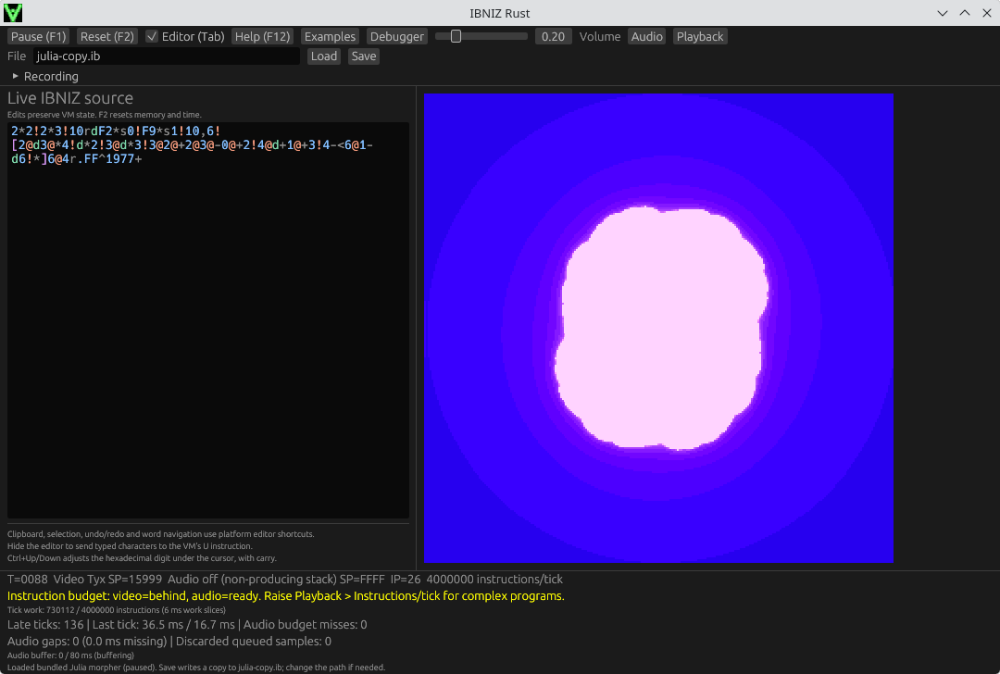

# IBNIZ Rust

A standalone Rust implementation of [IBNIZ](https://github.com/viznut/IBNIZ),
Ville-Matias Heikkila's compact audiovisual virtual machine. Create animated
visuals and sound with tiny programs in a live editor, or render them offline.
This is an **altered implementation**, not the original C distribution.



## Features

- Live code editing with syntax highlighting, video and audio, and optional variable-FPS playback.
- 284 bundled examples with search, credits and source references.
- Single-step debugger, stack/memory inspection and an offline language manual.
- PPM/WAV recording and headless rendering; optional MP4 conversion with FFmpeg.
- NSM session support and a reusable Rust VM library.

## Get started

Download installers for Linux (`.deb` / `.rpm`), macOS (`.dmg`, Intel and
Apple Silicon), and Windows (`.msi`) from
[GitHub Releases](https://github.com/ycollet/IBNIZ-rust/releases).
Builds are unsigned or ad-hoc signed; verify their source and checksums before
approving installation. See [installation details](DOCUMENTATION.md#installers)
for platform requirements and security notices.

To run from source, install Rust 1.88+ and the
[platform build dependencies](DOCUMENTATION.md#run), then:

```sh
cargo run --release
cargo run --release -- examples/ibnizdemo.ib
cargo run --release -- -c '^xp M d3r15&*'
```

Click **Examples** to load a program, **F1** to run/pause, **F2** to reset,
and **F12** for help. Edits recompile without resetting the VM.

**Warning:** examples can flash rapidly and produce loud noise. Keep volume
low, or use `--no-audio`. FFmpeg is installed separately for MP4 conversion.

For offline rendering without desktop dependencies:

```sh
cargo run --release --no-default-features -- \
  --headless -c '^xp M d3r15&*' --frames 120 \
  --output output --wav output/sound.wav
```

## Documentation

The full guide is in **[DOCUMENTATION.md](DOCUMENTATION.md)**: installation,
editor controls, playback tuning, debugger, recording, NSM, headless exports,
library usage, compatibility, development and benchmarks.

Browse the [example catalog](examples/README.md), read the
[original language manual](ibniz.txt), or see [TODO.md](TODO.md) for optimization
measurements and remaining work.

## License

[Zlib](LICENSE). Original IBNIZ by Ville-Matias Heikkila (viznut); the Rust
implementation and frontend are an altered version. Bundled examples retain
their [source credits and license notices](examples/README.md).
